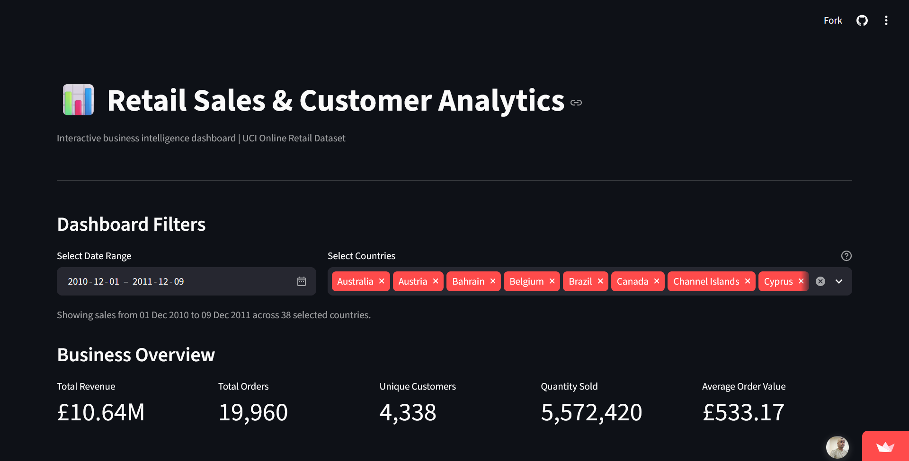
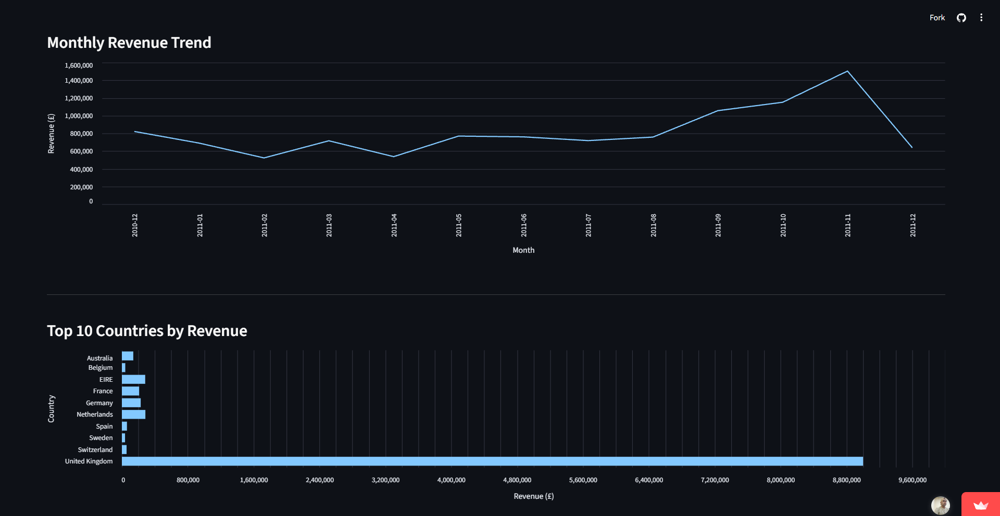
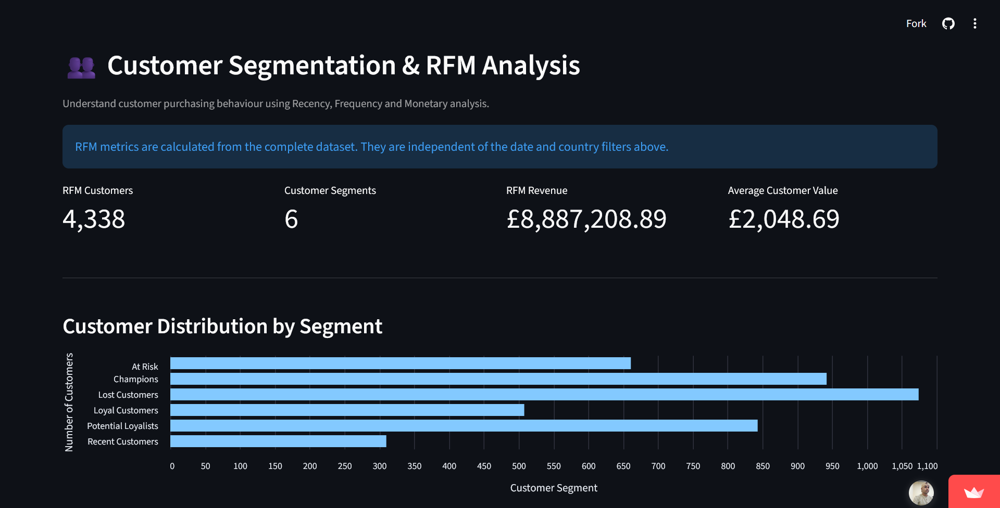
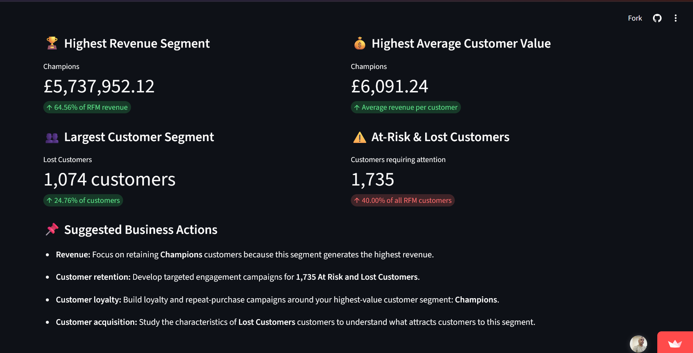
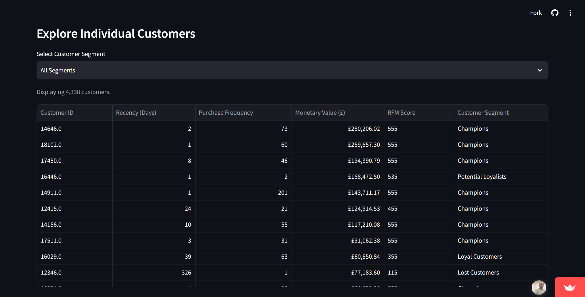

# Retail Sales & Customer Analytics

An end-to-end data analytics project that explores retail transaction data to uncover sales trends, understand customer purchasing behaviour, perform RFM-based customer segmentation, and present business insights through an interactive Streamlit dashboard.

**Tech Stack:** Python · Pandas · NumPy · PostgreSQL · SQL · SQLAlchemy · Matplotlib · Seaborn · Streamlit

**Dashboard:** [Retail Sales Analytics Dashboard](https://retail-salesanalytics.streamlit.app/)

---

## Project Overview

This project uses the **Online Retail dataset** from the UCI Machine Learning Repository to analyse retail transactions from December 2010 to December 2011.

The dataset contains 541,909 transaction records from a UK-based online retailer.

The project follows an end-to-end analytics workflow, starting with data exploration and cleaning, followed by PostgreSQL integration, SQL-based business analysis, customer segmentation, data visualization, and dashboard development.

### Project Objectives

- Analyse overall retail sales performance and revenue trends.
- Identify top-performing products and countries.
- Understand customer purchasing patterns and repeat purchases.
- Perform RFM (Recency, Frequency, Monetary) customer segmentation.
- Identify valuable, loyal, at-risk, and lost customer groups.
- Build an interactive dashboard to communicate business insights.

---

## Key Features

### 1. Exploratory Data Analysis and Data Cleaning

- Explored the original 541,909 transaction records.
- Identified duplicate records and missing values.
- Converted transaction dates into appropriate datetime formats.
- Preserved CustomerID as an identifier.
- Identified cancelled invoices, potential returns, zero-priced items, and negative price adjustments.
- Calculated transaction revenue using Quantity × UnitPrice.

After removing exact duplicate records, the cleaned dataset contains **536,641 records**.

### 2. SQL-Based Business Analysis

Performed business analysis using PostgreSQL, including:

- Overall business KPIs.
- Monthly revenue and order trends.
- Top 10 products by revenue.
- Top 10 countries by revenue.
- Top 10 customers by revenue.
- Cancellation and return analysis.
- Monthly revenue ranking using window functions.
- Customer purchase frequency analysis.

**SQL concepts demonstrated:**
- Aggregate functions
- GROUP BY and ORDER BY
- Common Table Expressions (CTEs)
- Window functions
- RANK()
- CASE statements
- Date-based analysis

### 3. RFM Customer Segmentation

Implemented RFM analysis to understand customer purchasing behaviour.

The analysis evaluates:

- **Recency:** How recently a customer made a purchase.
- **Frequency:** How frequently a customer made purchases.
- **Monetary:** How much a customer spent.

Customers receive scores from 1 to 5 for each RFM dimension using quantile-based scoring.

The resulting RFM scores are used to classify customers into six segments:

| Customer Segment | Customers |
|---|---:|
| Champions | 942 |
| Loyal Customers | 508 |
| Potential Loyalists | 843 |
| Recent Customers | 310 |
| At Risk | 661 |
| Lost Customers | 1,074 |
| **Total** | **4,338** |

The segment-level analysis also calculates average recency, average frequency, average monetary value, and total segment revenue.

### 4. Interactive Streamlit Dashboard

The dashboard provides an interactive interface for exploring retail sales and customer analytics.

Features include:

- Business overview and KPI cards.
- Monthly revenue trends.
- Top 10 countries by revenue.
- Date-range filtering.
- Country-based multiselect filtering.
- Customer segment insights.
- Business insights and suggested actions.
- Customer exploration.

**Note:** The RFM customer insights panel uses the complete RFM dataset and is independent of the dashboard's date and country filters.

### Dashboard Screenshots

#### Dashboard Overview


#### Sales Analysis


#### Customer Segmentation


#### Business Insights


#### Customer Exploration


---

## Visualizations

The project generates the following visualizations using Python:

| Visualization | Description |
|---|---|
| Monthly Revenue | Monthly sales revenue trends |
| Revenue by Country | Revenue contribution across countries |
| Customer Segments | Distribution of RFM customer segments |
| Customer Acquisition and Retention | New and returning customer trends |
| Customer Revenue Pareto | Customer revenue contribution analysis |

Generated charts are stored in the `reports/` directory.

---

## Technology Stack

| Category | Technologies |
|---|---|
| Programming Language | Python |
| Data Manipulation | Pandas, NumPy |
| Database | PostgreSQL |
| Query Language | SQL |
| Database Integration | SQLAlchemy, psycopg2 |
| Data Visualization | Matplotlib, Seaborn |
| Dashboard | Streamlit |
| Environment Management | python-dotenv |
| Development Tools | Jupyter Notebook, VS Code |
| Version Control | Git, GitHub |

---

## Project Structure

```text
retail-sales-analytics/
│
├── dashboard/
│   └── app.py
│
├── data/
│   ├── raw/
│   └── processed/
│
├── notebooks/
│   ├── 01_exploratory_data_analysis.ipynb
│   └── 02_sales_analysis.ipynb
│
├── reports/
│   ├── customer_acquisition_retention.png
│   ├── customer_revenue_pareto.png
│   ├── customer_segments.png
│   ├── monthly_revenue.png
│   ├── revenue_by_country.png
│   └── visualization.py
│
├── screenshots/
│   ├── business-insights.png
│   ├── customer-exploration.png
│   ├── customer-segmentation.png
│   ├── dashboard-overview.png
│   └── sales-analysis.png
│
├── scripts/
│   ├── clean_data.py
│   ├── db_connection.py
│   ├── download_data.py
│   ├── load_data.py
│   └── load_rfm_data.py
│
├── sql/
│   ├── 01_sales_analysis.sql
│   ├── 09_create_rfm_tables.sql
│   ├── 10_rfm_customer_analysis.sql
│   └── 11_advanced_business_analysis.sql
│
├── .env.example
├── .gitignore
├── README.md
└── requirements.txt
```

**Note:** Raw and processed CSV files are generated locally and are not included in the repository.

---

## Getting Started

Follow these steps to run the project locally.

### 1. Clone the Repository

```bash
git clone https://github.com/amitshah12/retail-sales-analytics.git

cd retail-sales-analytics
```

### 2. Create and Activate a Virtual Environment

```bash
python -m venv venv
```

On Windows CMD:

```cmd
venv\Scripts\activate
```

### 3. Install Dependencies

Install the project dependencies:

```bash
pip install -r requirements.txt
```

For notebook analysis and Python visualizations, also install:

```bash
pip install jupyter numpy matplotlib seaborn
```

### 4. Configure PostgreSQL

Make sure PostgreSQL is installed and running.

Create a database named:

```sql
CREATE DATABASE retail_analytics;
```

Create a `.env` file in the project root using `.env.example` as a reference.

Configure your database credentials:

```env
DB_USER=your_postgres_username
DB_PASSWORD=your_postgres_password
DB_HOST=localhost
DB_PORT=5432
DB_NAME=retail_analytics
DB_SSLMODE=prefer
```

Use your own PostgreSQL credentials. Do not commit the `.env` file to GitHub.

### 5. Download the Dataset

Run:

```bash
python scripts/download_data.py
```

This downloads the Online Retail dataset and saves the raw CSV under:

```text
data/raw/online_retail.csv
```

### 6. Clean and Transform the Dataset

Run:

```bash
python scripts/clean_data.py
```

The script removes exact duplicate records, converts data types, creates transaction classification flags, calculates revenue, and exports:

```text
data/processed/online_retail_cleaned.csv
```

### 7. Load Transactions into PostgreSQL

Run:

```bash
python scripts/load_data.py
```

This imports the cleaned transaction data into:

```text
public.retail_transactions
```

**Important:** The loader uses table replacement. Running it again replaces the existing transaction table.

### 8. Perform SQL Business Analysis

Open the SQL scripts in pgAdmin or another PostgreSQL client and execute them against the `retail_analytics` database.

Start with:

```text
sql/01_sales_analysis.sql
```

This contains eight sales and customer analysis queries.

### 9. Generate RFM Customer Data

Launch Jupyter Notebook:

```bash
jupyter notebook
```

Open:

```text
notebooks/02_sales_analysis.ipynb
```

Run the notebook cells to perform RFM analysis, assign customer segments, calculate segment-level summaries, and export:

```text
data/processed/customer_rfm.csv
data/processed/rfm_segment_summary.csv
```

### 10. Create and Load RFM Tables

Execute:

```text
sql/09_create_rfm_tables.sql
```

This creates the PostgreSQL tables required for RFM analysis.

Then run:

```bash
python scripts/load_rfm_data.py
```

The script loads both RFM datasets into PostgreSQL and verifies the imported record counts.

### 11. Execute Advanced SQL Analysis

Execute the following SQL scripts:

```text
sql/10_rfm_customer_analysis.sql
sql/11_advanced_business_analysis.sql
```

These contain customer segment analysis and advanced business queries using CTEs and window functions.

### 12. Generate Visualizations

Run:

```bash
python reports/visualization.py
```

Generated visualization files are saved under `reports/`.

### 13. Launch the Streamlit Dashboard

Run:

```bash
streamlit run dashboard/app.py
```

The dashboard should open locally at:

```text
http://localhost:8501
```

---

## Dataset Information and Attribution

**Dataset:** Online Retail

**Source:** UCI Machine Learning Repository

**Dataset ID:** 352

**Time Period:** December 2010 – December 2011

**Original Records:** 541,909

**License:** Creative Commons Attribution 4.0 International (CC BY 4.0)

Dataset link:

https://archive.ics.uci.edu/dataset/352/online+retail

The dataset is not included in this repository. It can be downloaded using the provided `scripts/download_data.py` script.

Attribution: Chen, D. (2015). *Online Retail* [Dataset]. UCI Machine Learning Repository. https://doi.org/10.24432/C5BW33

---

## Project Status

The project includes:

- Exploratory data analysis and data cleaning.
- PostgreSQL database integration.
- SQL-based sales and customer analysis.
- RFM customer segmentation.
- Python-based data visualizations.
- Interactive Streamlit dashboard.
- GitHub project documentation.

---

## Author

**Amit Shah**

B.Tech – Computer Science and Engineering

- GitHub: https://github.com/amitshah12
- LinkedIn: https://www.linkedin.com/in/amitshah-net60/
- Email: amitshah.net60@gmail.com

---

*Built as a hands-on data analytics project to apply Python, SQL, PostgreSQL, customer analytics, and dashboard development to a real-world retail dataset.*