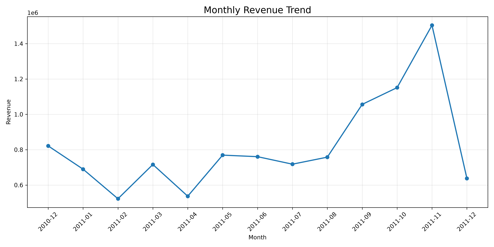
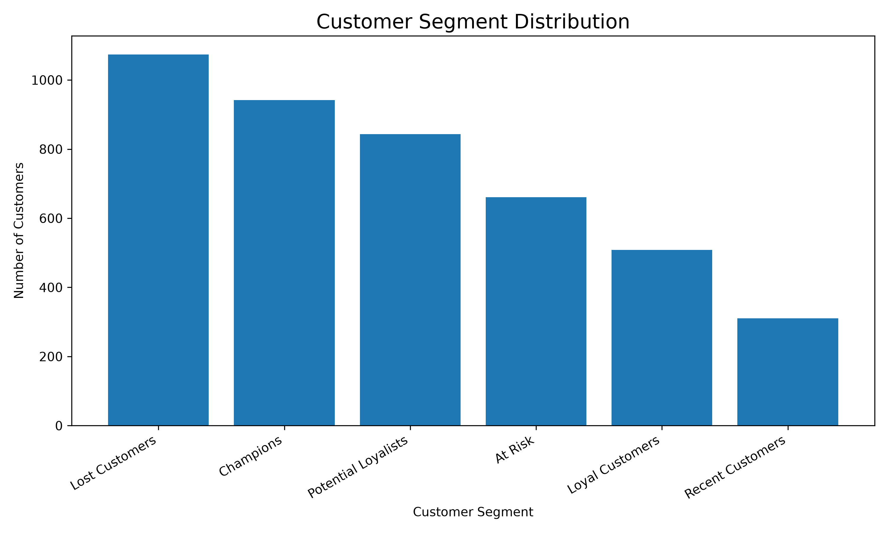
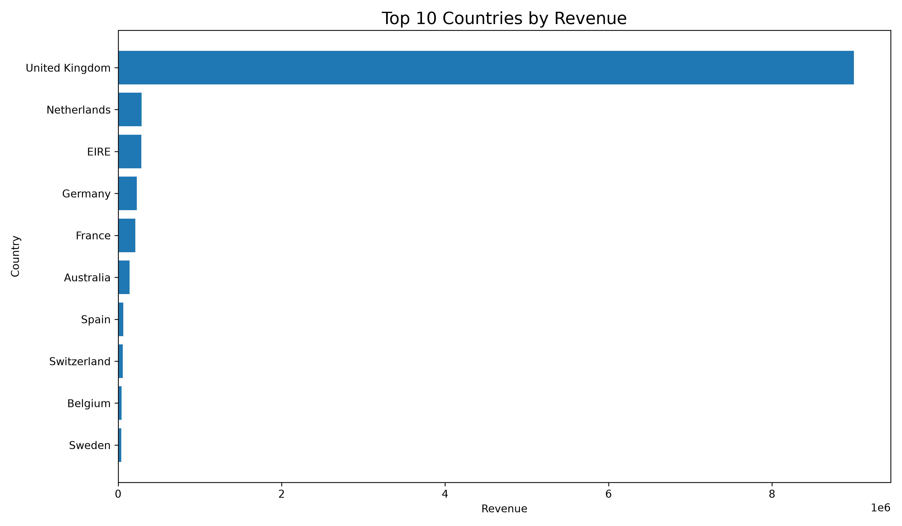
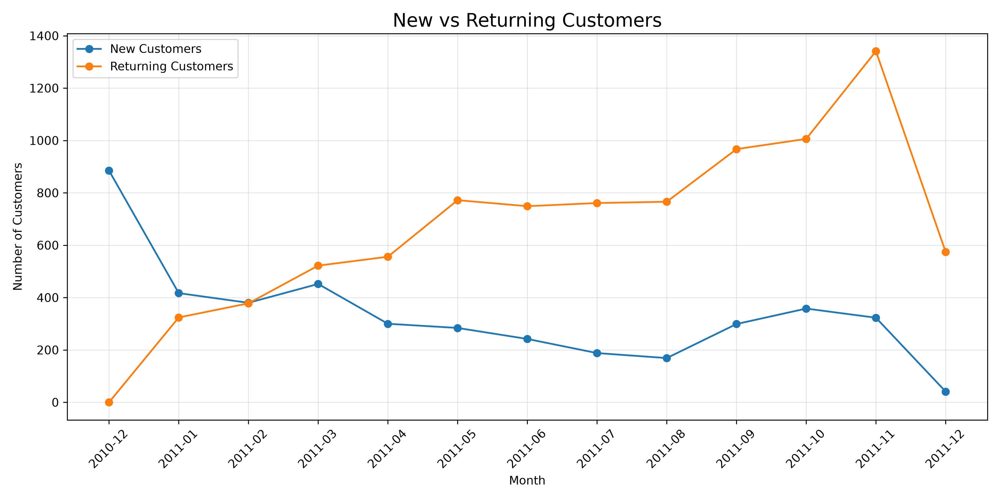
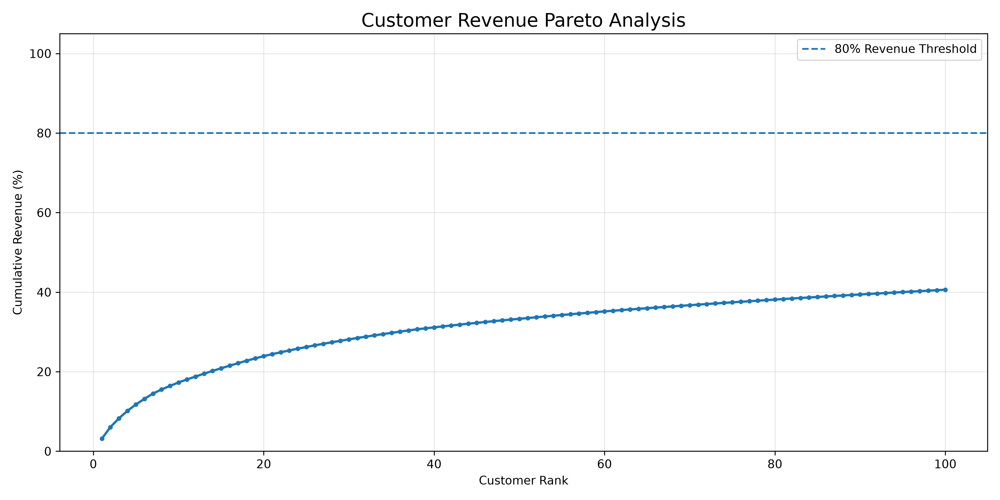

# Retail Sales & Customer Analytics

An end-to-end retail data analytics project using **Python, PostgreSQL, SQL, Pandas, and Streamlit** to explore historical sales performance, analyze customer purchasing behavior, and generate actionable business insights.

## Project Overview

This project analyzes the UCI Online Retail dataset, which contains 541,909 transaction records covering December 2010 to December 2011.

The project combines data preparation, relational database analysis, customer segmentation, and interactive business intelligence visualizations.

**Key objectives:**
- Analyze retail revenue and sales performance.
- Identify revenue contributions across countries and customers.
- Understand customer acquisition and repeat purchasing behavior.
- Segment customers using Recency, Frequency, and Monetary (RFM) analysis.
- Present findings through an interactive dashboard.

## Technology Stack

| Category | Technologies |
|---|---|
| Programming | Python |
| Data Processing | Pandas, NumPy |
| Database | PostgreSQL |
| SQL Analysis | PostgreSQL SQL, CTEs, window functions |
| Database Connectivity | SQLAlchemy, psycopg2 |
| Visualization | Matplotlib |
| Dashboard | Streamlit |
| Development | VS Code, Git, GitHub |

## Features

### Sales Performance Analysis
- Total sales revenue
- Total orders and unique customers
- Quantity sold and average order value
- Monthly revenue trends
- Revenue contribution by country
- Month-over-month revenue growth
- Cumulative revenue analysis

### Customer Analytics
- Customer revenue ranking
- New versus returning customer analysis
- Customer revenue contribution and Pareto analysis
- RFM customer segmentation
- Customer segment distribution and business insights

### Interactive Dashboard
- Date-range filtering
- Country-based filtering
- Business KPI cards
- Monthly revenue visualization
- Top countries by revenue
- Customer segmentation and RFM insights
- Suggested business actions

**Note:** The RFM analysis uses the complete dataset and is independent of the dashboard's date and country filters.

## Dataset

**Source:** [UCI Machine Learning Repository — Online Retail](https://archive.ics.uci.edu/dataset/352/online+retail)

The dataset contains transaction-level information including invoice numbers, product codes, descriptions, quantities, invoice dates, unit prices, customer identifiers, and countries.

The original dataset is provided by the UCI Machine Learning Repository under the Creative Commons Attribution 4.0 International (CC BY 4.0) license.

The dataset is not included directly in this repository. It can be retrieved from the original source using the project's download script.

## Project Structure

```text
retail-sales-analytics/
├── dashboard/
│   └── app.py
├── data/
│   ├── raw/
│   └── processed/
├── notebooks/
├── reports/
│   ├── visualization.py
│   ├── monthly_revenue.png
│   ├── customer_segments.png
│   ├── revenue_by_country.png
│   ├── customer_acquisition_retention.png
│   └── customer_revenue_pareto.png
├── scripts/
│   └── download_data.py
├── sql/
├── .env.example
├── .gitignore
├── requirements.txt
└── README.md
```

Additional scripts, notebooks, and SQL files are organized in their respective directories.

## Getting Started

### 1. Clone the repository

```bash
git clone https://github.com/amitshah12/retail-sales-analytics.git
cd retail-sales-analytics
```

### 2. Create a virtual environment

```bash
python -m venv venv
```

Activate it on Windows:

```bash
venv\Scripts\activate
```

### 3. Install dependencies

```bash
pip install -r requirements.txt
```

### 4. Configure PostgreSQL

Install PostgreSQL and create a database named:

```text
retail_analytics
```

Copy `.env.example` to `.env` and configure your local PostgreSQL credentials.

```env
DB_USER=your_postgres_username
DB_PASSWORD=your_postgres_password
DB_HOST=localhost
DB_PORT=5432
DB_NAME=retail_analytics
```

Never commit your `.env` file or database credentials to GitHub.

### 5. Download the dataset

```bash
python scripts/download_data.py
```

### 6. Prepare and load the database

Run the project's data cleaning, transformation, and PostgreSQL loading scripts, followed by the SQL analysis and RFM segmentation scripts in their documented execution order.

### 7. Generate visualizations

```bash
python reports/visualization.py
```

The generated charts are saved in the `reports/` directory.

### 8. Launch the Streamlit dashboard

```bash
streamlit run dashboard/app.py
```

Open the local URL displayed by Streamlit, normally:

```text
http://localhost:8501
```

## Visualizations

### Monthly Revenue Trend



### Customer Segment Distribution



### Revenue by Country



### New vs Returning Customers



### Customer Revenue Pareto Analysis



## Business Insights

The project supports business analysis in several areas:

- **Revenue performance:** Identify seasonal patterns and changes in monthly sales.
- **Geographic performance:** Compare revenue contributions across countries.
- **Customer value:** Identify high-value customer groups and their revenue contributions.
- **Retention opportunities:** Examine customers classified as At Risk or Lost using RFM segmentation.
- **Customer engagement:** Develop targeted recommendations based on customer purchasing behavior.

These insights are derived from historical transactions and are intended for analytical demonstration rather than claims about current retail performance.

## Project Status

Core data processing, PostgreSQL analysis, visualization generation, and the interactive Streamlit dashboard are implemented.

Analytical validation, deployment, and final portfolio integration are planned as subsequent improvements.

## Author

**Amit Shah**

- [GitHub](https://github.com/amitshah12)
- [LinkedIn](https://www.linkedin.com/in/amitshah-net60/)
